# Lab6Web — Praktikum JavaScript DOM dan Event Handling

## Tujuan

Praktikum ini bertujuan memahami DOM, memilih dan memanipulasi elemen HTML, menangani event pengguna, melakukan validasi form, dan membuat halaman web interaktif.

## Langkah Kerja dan Hasil

1. **Latihan 1 — Mengubah teks dengan DOM:** klik tombol “Ubah teks”. Judul dan paragraf berubah.
2. **Latihan 2 — Event click:** klik “Klik Saya”. Halaman menampilkan waktu saat tombol diklik.
3. **Latihan 3 — Mengubah kelas dan gaya CSS:** klik “Ubah gaya” untuk menambahkan atau menghapus kelas highlight dan teks besar.
4. **Latihan 4 — Penghitung karakter:** ketik atau hapus teks pada kolom nama. Jumlah karakter berubah secara langsung.
5. **Latihan 5 — Validasi form:** uji nama kosong, email salah, usia di bawah 17, dan data valid.
6. **Latihan 6 — To-do List:** tambah tugas, tandai selesai, batalkan status selesai, dan hapus satu tugas.
7. **Mini Project — Pendaftaran Workshop:** isi nama minimal tiga karakter, email valid, dan pilih sesi. Ringkasan diperbarui langsung dan form menampilkan pesan hasil validasi.
8. **Eksperimen Mandiri:** fitur hapus tugas, validasi nama minimal tiga karakter, event `change` pada sesi workshop, dan tombol sembunyikan/tampilkan paragraf sudah dibuat.

## Pertanyaan Evaluasi

### 1. Apa yang dimaksud dengan DOM dan apa manfaatnya?

DOM (Document Object Model) adalah representasi dokumen HTML dalam bentuk objek yang dapat diakses oleh JavaScript. DOM bermanfaat untuk memilih elemen, mengubah teks dan atribut, mengatur kelas CSS, serta membuat halaman merespons tindakan pengguna.

### 2. Apa perbedaan `getElementById()`, `querySelector()`, dan `querySelectorAll()`?

- `getElementById()` memilih satu elemen berdasarkan nilai `id`.
- `querySelector()` memilih elemen pertama yang cocok dengan selector CSS.
- `querySelectorAll()` memilih semua elemen yang cocok dengan selector CSS dan mengembalikannya sebagai NodeList.

### 3. Apa fungsi `addEventListener()` dan sebutkan tiga contoh event?

`addEventListener()` digunakan untuk menjalankan fungsi ketika suatu event terjadi pada elemen. Contoh event adalah `click`, `input`, dan `submit`.

### 4. Mengapa `event.preventDefault()` digunakan pada event submit form?

`event.preventDefault()` mencegah perilaku bawaan form, seperti memuat ulang halaman, sehingga JavaScript dapat memeriksa input dan menampilkan pesan validasi terlebih dahulu.

### 5. Apa perbedaan `textContent` dan `innerHTML` dari sisi penggunaan dan keamanan?

`textContent` membaca atau mengubah isi elemen sebagai teks biasa. `innerHTML` membaca atau mengubah isi sebagai markup HTML. `textContent` lebih aman untuk menampilkan input pengguna karena teks tidak ditafsirkan sebagai HTML.

### 6. Bagaimana `classList.toggle()` membantu mengubah tampilan elemen?

`classList.toggle()` menambahkan kelas jika kelas tersebut belum ada dan menghapusnya jika sudah ada. Dengan demikian, tampilan elemen dapat diubah secara bergantian melalui aturan CSS.

### 7. Sebutkan minimal tiga skenario pengujian validasi form.

- Nama tidak diisi.
- Email menggunakan format yang tidak valid.
- Usia kurang dari 17 tahun.
- Semua data diisi dengan benar.
- Pada form workshop, nama kurang dari tiga karakter atau sesi belum dipilih.

## Eksperimen Mandiri 5 — Script tanpa `defer`

Jika file JavaScript diletakkan di bagian `<head>` tanpa `defer`, JavaScript dapat dijalankan sebelum elemen HTML selesai dibaca oleh browser. Akibatnya, pemanggilan elemen dengan `getElementById()` atau selector lain bisa menghasilkan `null`. Atribut `defer` membuat script eksternal dijalankan setelah HTML selesai diparsing.

## Screenshot hasil

<h3>Latihan 1 — Mengubah Teks dengan DOM</h3>
menggunakan JavaScript untuk mengubah teks pada halaman web melalui interaksi pengguna.
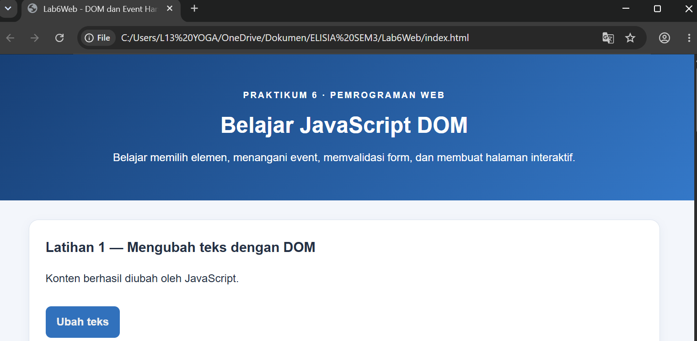

<h3>Latihan 2 — Event Click</h3>
menggunakan event click untuk menjalankan fungsi ketika tombol ditekan dan menampilkan waktu saat tombol diklik.
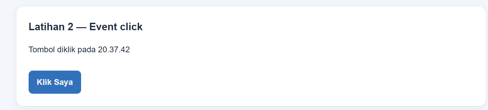

<h3>Latihan 3 — Mengubah Gaya CSS</h3>
menunjukkan cara JavaScript mengubah tampilan elemen HTML menggunakan class CSS.
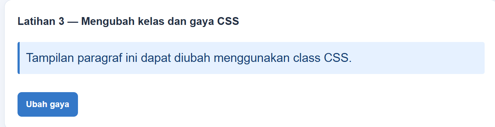

<h3>Latihan 4 — Event Input dan Penghitung Karakter</h3>
menghitung jumlah karakter yang diketik pengguna pada kolom input dan memperbarui jumlahnya secara langsung.
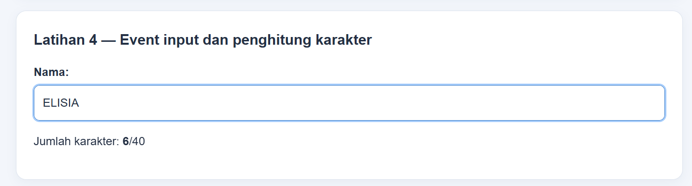

<h3>Latihan 5 — Validasi Form Kosong</h3>
Pengujian ini dilakukan dengan mengirim form tanpa mengisi data untuk memastikan program menampilkan pesan validasi.
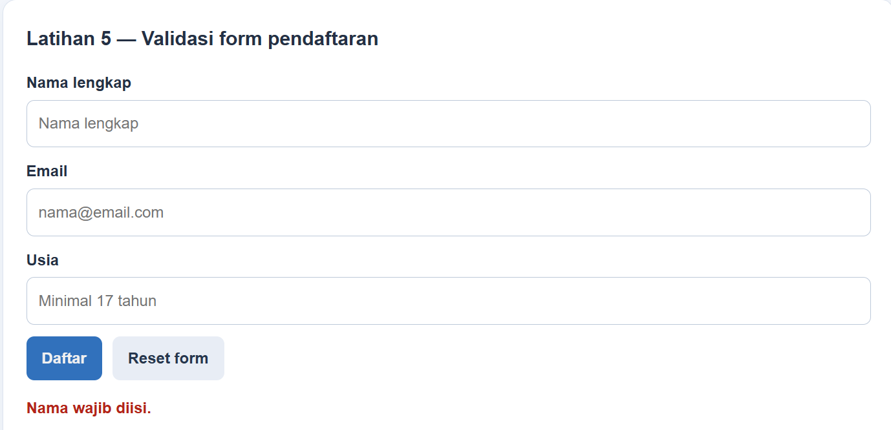

<h3>Latihan 5 — Validasi Email Tidak Valid</h3>
Pengujian ini menggunakan format email yang salah untuk memastikan program menolak data yang tidak sesuai.
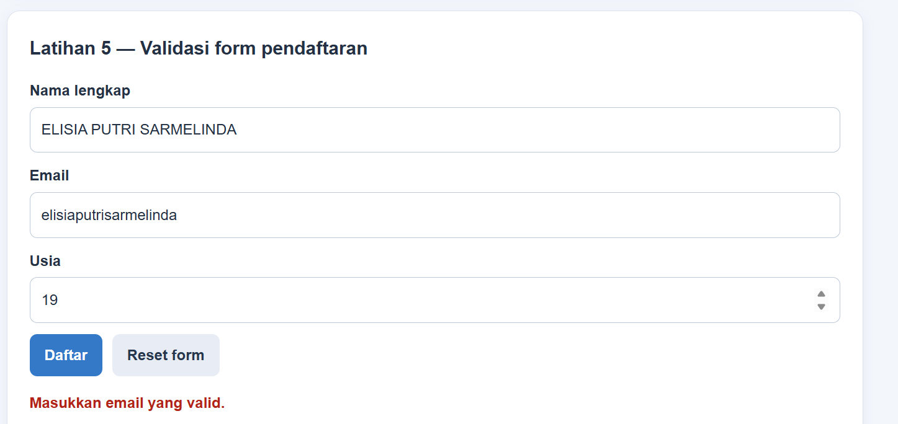

<h3>Latihan 5 — Validasi Usia Kurang dari 17 Tahun</h3>
Pengujian ini memastikan program menolak usia di bawah 17 tahun sesuai ketentuan validasi form.
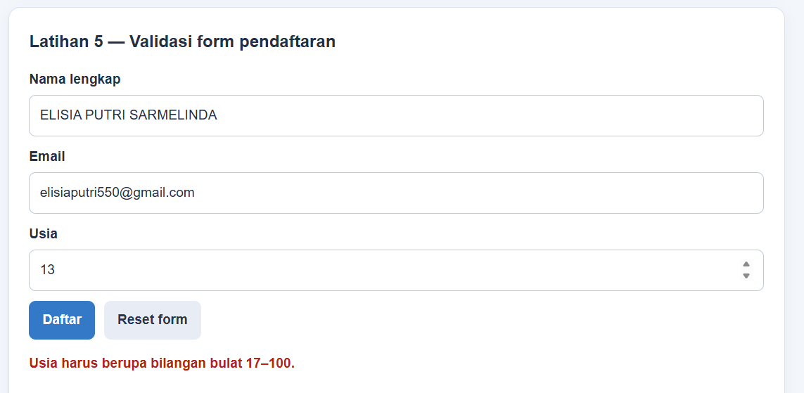

<h3>Latihan 5 — Validasi Form Berhasil</h3>
Pengujian ini menggunakan nama, email, dan usia yang valid untuk memastikan form dapat diproses tanpa kesalahan validasi.
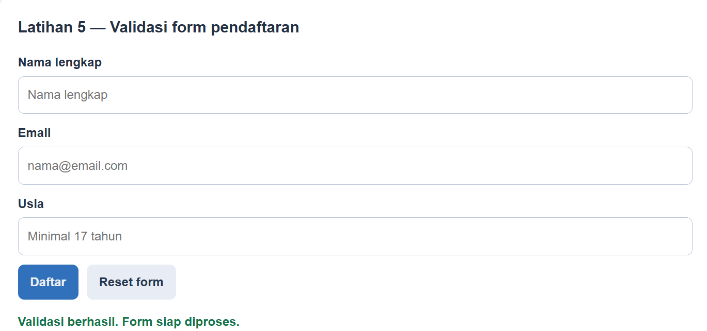

<h3>Latihan 6 — Menambahkan dan Menandai Tugas</h3>
membuat daftar tugas yang dapat ditambahkan dan ditandai selesai untuk membantu pengguna mengelola tugas.
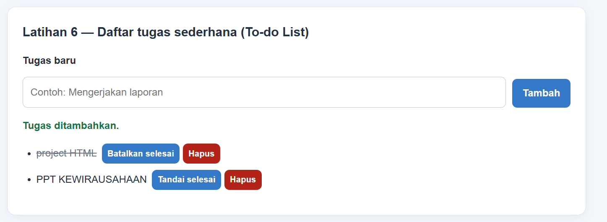

<h3>Eksperimen Mandiri 1 — Menghapus Tugas</h3>
Eksperimen ini menguji fungsi penghapusan agar tugas yang tidak diperlukan dapat dihilangkan dari daftar.
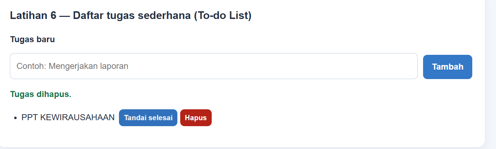

<h3>Mini Project — Validasi Nama Tidak Memenuhi Ketentuan</h3>
Pengujian ini memastikan formulir pendaftaran workshop menolak data yang tidak memenuhi ketentuan, misalnya nama yang terlalu pendek.
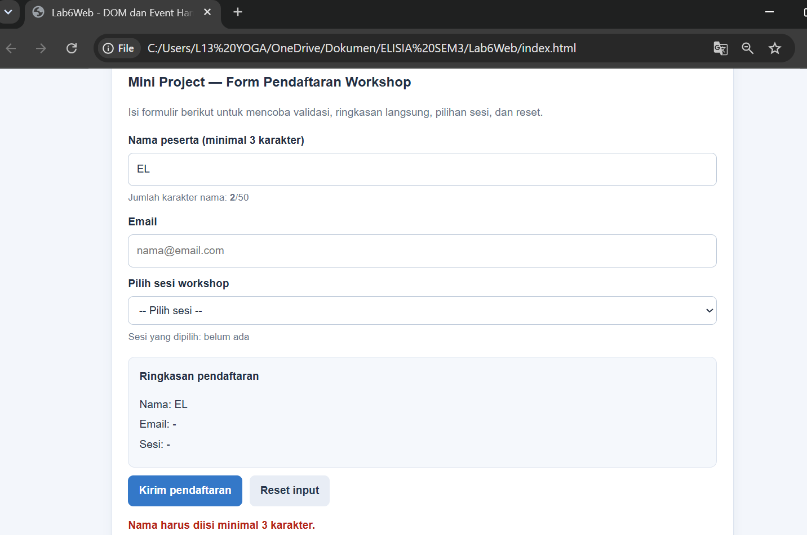

<h3>Mini Project — Pendaftaran Workshop Berhasil</h3>
Pengujian ini menunjukkan formulir workshop ketika data peserta telah diisi sesuai ketentuan dan berhasil melewati validasi.
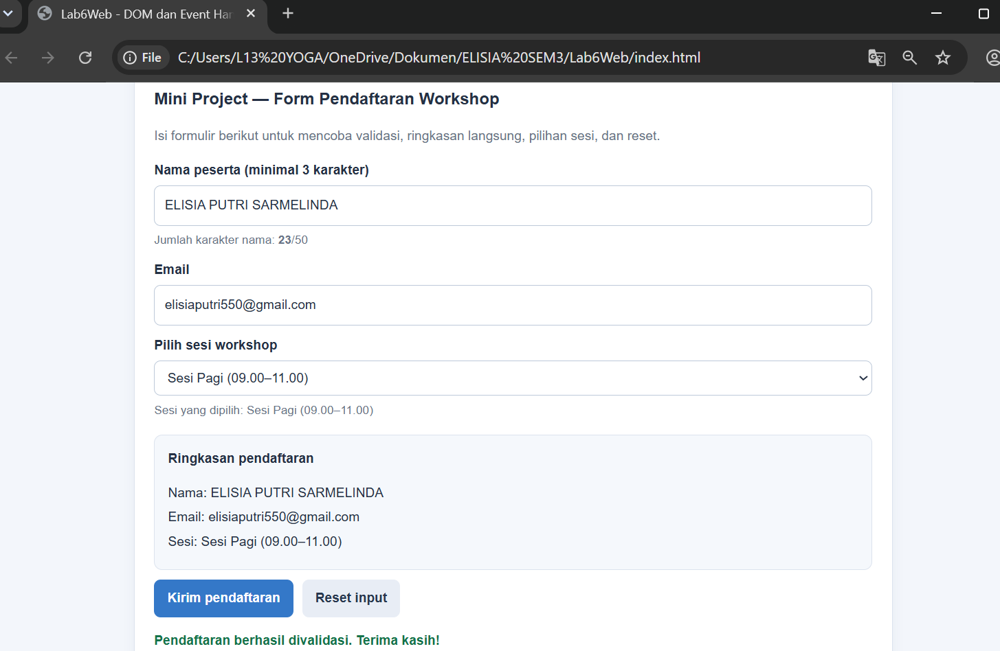

<h3>Mini Project — Penghitung Karakter dan Ringkasan Pendaftaran</h3>
Bagian ini menunjukkan pembaruan jumlah karakter serta ringkasan informasi pendaftaran berdasarkan data yang dimasukkan pengguna.
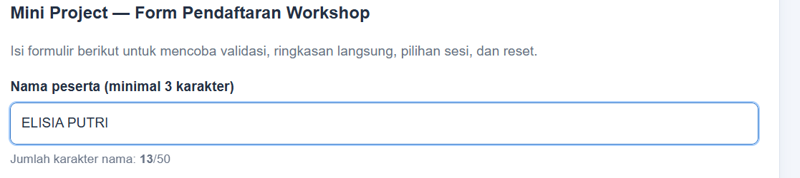

<h3>Eksperimen Mandiri 3 — Event Change pada Dropdown Sesi</h3>
Eksperimen ini menggunakan event change untuk merespons perubahan pilihan sesi workshop oleh pengguna.
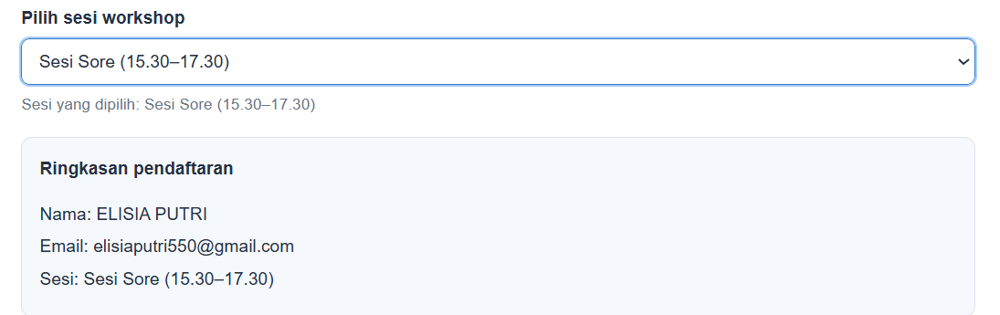

<h3>Eksperimen Mandiri 4 — Menyembunyikan Paragraf</h3>
Eksperimen ini menggunakan JavaScript dan class CSS untuk menyembunyikan paragraf dari tampilan halaman.
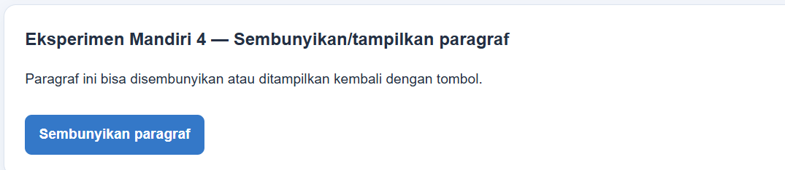

<h3>Eksperimen Mandiri 4 — Menampilkan Paragraf Kembali</h3>
Eksperimen ini menguji perubahan tampilan dengan menampilkan kembali paragraf yang sebelumnya disembunyikan.
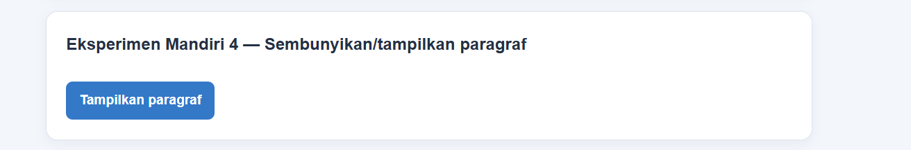
